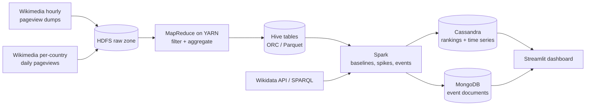

# Wikipedia Attention Radar

**Detecting real-world events from sudden spikes in what people read on Wikipedia**, filterable by country, state/region, category and language.

> Big Data Analytics course project. It uses HDFS, MapReduce, YARN, Hive, Spark, Cassandra and MongoDB on open Wikimedia data.

---

## What it does

When something big happens (an election result, a cricket final, an earthquake, a phone launch), people rush to Wikipedia to read about it. Attention Radar:

1. Ingests the **hourly view counts of every Wikipedia article** (billions of rows) and the **daily per-country view counts**.
2. Learns each article's **normal level** of attention, separately for every language and country.
3. Flags **spikes**: hours or days where attention jumps far above normal.
4. **Groups** related spiking articles into one **event** (e.g. *Election results* + *party leader* + *constituency*).
5. Tags every event with a **category** (Politics, Sports, ...) and a **location** (country → state → city) using Wikidata.
6. Serves it all on a **dashboard** that opens on global spikes and lets you narrow down:
   - **Readers in** a country: what people in India are suddenly reading
   - **Events about** a country, state or city: what is happening in Rajasthan
   - by **category** and **language**, and over 24 hours, 7 days or 30 days

## Architecture at a glance



## Tech stack

| Layer | Technology |
|---|---|
| Storage | HDFS (Hadoop 3.3.6) |
| Batch processing | MapReduce (Hadoop Streaming, Python) on YARN |
| Warehouse / SQL | Apache Hive 4 (RegexSerDe, ORC, Parquet, UDF) |
| Analytics | Apache Spark 3.5 (PySpark: RDD, DataFrame, Spark SQL) |
| Serving: time series and rankings | Apache Cassandra 4.1 |
| Serving: event documents | MongoDB 7 |
| Enrichment | Wikidata API + SPARQL |
| Dashboard | Streamlit + Plotly |
| Environment | Docker Desktop (docker compose) |

## Repository structure

```
wiki-attention-radar/
├── README.md
├── docs/                       # all project documents (see index below)
├── config/settings.yaml        # dates, languages, thresholds, paths
├── docker/                     # compose file + Hadoop/Hive configs + Dockerfile
├── scripts/                    # download, HDFS load, DB init, run-all helpers
├── mapreduce/                  # Hadoop Streaming mappers/reducers + run scripts
├── hive/                       # HQL scripts + Java UDF
├── spark/                      # PySpark jobs (baselines, spikes, enrichment, events, loaders)
├── enrichment/                 # Wikidata client + category rules
├── dashboard/                  # Streamlit app + data access layer
├── data/validation/            # known-events list used to measure detection quality
├── benchmarks/                 # benchmark scripts + results
└── tests/                      # pytest unit + integration tests
```

## Quick start

> Full instructions: [`docs/05_SETUP.md`](docs/05_SETUP.md)

```bash
# 1. Build and start the cluster
cd docker
docker compose --profile hadoop build
docker compose --profile hadoop --profile hive --profile nosql up -d

# 2. Download a small development slice (2 days) and load it into HDFS
docker compose exec edge python3 /workspace/scripts/download_hourly.py --dev
docker compose exec edge python3 /workspace/scripts/download_country.py --dev
docker compose exec edge bash /workspace/scripts/load_hdfs.sh

# 3. Run the pipeline end to end (host-side wrapper that calls the edge and hiveserver2 containers)
bash ../scripts/run_pipeline.sh --dev

# 4. Start the dashboard (on your machine)
pip install -r dashboard/requirements.txt
streamlit run dashboard/app.py
```

## Documents

| # | Document | What it covers |
|---|---|---|
| 01 | [PRD](docs/01_PRD.md) | Problem, users, goals, scope, requirements, success metrics |
| 02 | [Architecture](docs/02_ARCHITECTURE.md) | Components, data flow, data-access layer, security and privacy |
| 03 | [Data Model](docs/03_DATA_MODEL.md) | HDFS layout, Hive tables, Cassandra tables, MongoDB collections |
| 04 | [UI/UX Design](docs/04_UI_UX_DESIGN.md) | Dashboard layout, filters, states, visual system |
| 05 | [Setup](docs/05_SETUP.md) | Environment setup and initialisation, step by step |
| 06 | [Implementation Plan](docs/06_IMPLEMENTATION_PLAN.md) | Phases, timeline, deliverables |
| 07 | [Feature Development](docs/07_FEATURE_DEVELOPMENT.md) | How each feature is built: algorithms, jobs, configs |
| 08 | [Integration](docs/08_INTEGRATION.md) | External sources and stage-to-stage contracts |
| 09 | [Testing & QA](docs/09_TESTING_QA.md) | Unit, integration, data-quality, validation, acceptance |
| 10 | [Debugging](docs/10_DEBUGGING.md) | Known problems and fixes for every component |
| — | Build tracker | Interactive HTML checklist (kept as a separate page, not in the repo) |

## Data sources and licences

- **Wikimedia hourly pageview dumps:** `dumps.wikimedia.org/other/pageviews/`
- **Wikimedia per-country daily pageviews (differential privacy):** `analytics.wikimedia.org/published/datasets/country_project_page/`
- **Wikidata:** item metadata (category, location)

Wikimedia analytics data and Wikidata are published under CC0. This project uses only aggregated, anonymised public data; no personal data is collected or stored.

## Author

**Tanmay Rana** · [GitHub: tanmay-005](https://github.com/tanmay-005) · [LinkedIn](https://linkedin.com/in/tanmay-rana-13a7b4249)
