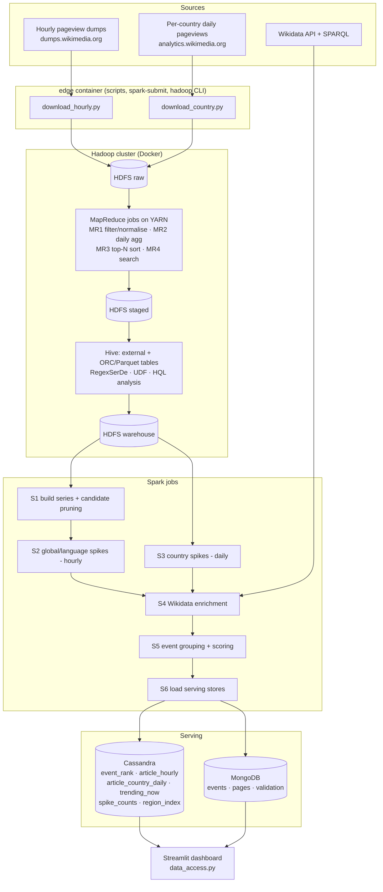

# 02 · Architecture

## 1. Overview

Attention Radar is a **batch Big Data pipeline** with a **NoSQL serving layer** and a **dashboard**. Data moves through four zones:

| Zone | Where | What lives there |
|---|---|---|
| **Raw** | HDFS `/radar/raw` | Downloaded files, unchanged |
| **Staged** | HDFS `/radar/staged` | MapReduce output: filtered, normalised, aggregated |
| **Warehouse** | HDFS `/radar/warehouse` (Hive) | Typed, partitioned ORC/Parquet tables |
| **Serving** | Cassandra + MongoDB | Rankings, time series and event documents shaped for the dashboard |



## 2. Components

### 2.1 Docker services

| Service | Image | Role | Ports (host) |
|---|---|---|---|
| `namenode` | `radar-hadoop:3.3.6` (custom) | HDFS metadata | 9870 (UI) |
| `datanode` | `radar-hadoop:3.3.6` | HDFS blocks | 9864 (UI) |
| `resourcemanager` | `radar-hadoop:3.3.6` | YARN scheduler | 8088 (UI) |
| `nodemanager` | `radar-hadoop:3.3.6` | YARN containers (runs mappers/reducers) | 8042 (UI) |
| `historyserver` | `radar-hadoop:3.3.6` | MapReduce job history | 19888 (UI) |
| `edge` | `radar-hadoop:3.3.6` | Client node: Hadoop CLI, Spark, Python, scripts. The repo is mounted at `/workspace` | 4040 (Spark UI) |
| `hiveserver2` | `apache/hive:4.0.1` | HiveServer2 + embedded metastore, reading/writing HDFS | 10000, 10002 |
| `cassandra` | `cassandra:4.1` | Serving: rankings, time series | 9042 |
| `mongo` | `mongo:7.0` | Serving: event documents | 27017 |

The **dashboard** runs on the host machine (Python 3.11) and connects to `localhost:9042` and `localhost:27017`.

**Why one custom Hadoop image?** Official older images (e.g. bde2020) run on archived Debian/CentOS releases where installing Python is unreliable. One image based on Ubuntu 22.04 + Java 11 with Hadoop 3.3.6, Spark 3.5.x and Python 3 makes every node consistent. Hadoop Streaming needs Python on the NodeManager, and Spark needs the same Python version on the driver and executors.

**Compose profiles** let low-RAM machines run groups of services:

| Profile | Services | When |
|---|---|---|
| `hadoop` | namenode, datanode, resourcemanager, nodemanager, historyserver, edge | Ingestion, MapReduce, Spark |
| `hive` | hiveserver2 | Hive phase |
| `nosql` | cassandra, mongo | Loading and dashboard |

### 2.2 Processing stages

| Stage | Tool | Input | Output |
|---|---|---|---|
| Download | Python (`edge`) | Wikimedia HTTP | Local disk → HDFS `/radar/raw/...` |
| MR1 filter_normalise | MapReduce (Streaming) | Raw hourly `.gz` | `/radar/staged/hourly/dt=.../` (lang, platform, title, hour, views) |
| MR2 daily_agg | MapReduce | MR1 output | `/radar/staged/daily/dt=.../` (lang, title, day, views) |
| MR3 top_n | MapReduce (secondary sort) | MR2 output | Top 100 per (lang, day) |
| MR4 search | MapReduce | MR1 output | All hours for a given title |
| Hive DDL/CTAS | Hive | Raw + staged | ORC/Parquet tables in `/radar/warehouse` |
| S1–S3 | Spark | ORC tables | Spike episodes (Parquet, `/radar/output/spikes_*`) |
| S4 | Spark + Python client | Spike keys | `page_meta` (Parquet) + MongoDB `pages` cache |
| S5 | Spark | Spikes + page_meta | Events (Parquet, `/radar/output/events`) |
| S6 | Spark + drivers | Events, series | Cassandra tables, MongoDB `events` |

### 2.3 Why each storage technology

| Need | Choice | Reason |
|---|---|---|
| Store ~25 GB of compressed raw files reliably, read sequentially by many tasks | **HDFS** | Write-once, large sequential reads; block distribution; replication |
| SQL over files, schema-on-read, partition pruning | **Hive** | External tables over HDFS; ORC/Parquet columnar formats |
| Heavy iterative computation (windows, joins, grouping) | **Spark** | In-memory DAG execution, much faster than chained MapReduce |
| "Top events for scope X on day D, by category" and "views of article A over time" | **Cassandra** | Query-first wide-column model; partition = one query; fast sorted slices; TTL and counters built in |
| Rich, nested event objects (articles, countries, curve, location) fetched by ID or filtered flexibly | **MongoDB** | Document model matches the event shape; secondary indexes; aggregation pipeline |

### 2.4 CAP / BASE positioning (for the report)

- **Cassandra** is **AP** (available and partition-tolerant) with tunable consistency. Writes use `LOCAL_ONE` during bulk load, reads use `ONE`. Rankings are rebuilt in batch, so eventual consistency is acceptable (**BASE**: basically available, soft state, eventually consistent).
- **MongoDB** (single node here; in a replica set it behaves as **CP**) gives strong consistency on the primary. Event documents are written once per batch and read by ID.
- **HDFS** favours consistency: the single NameNode is the source of truth for metadata.

## 3. Data flow in one run

1. `download_hourly.py` and `download_country.py` fetch files for the configured dates.
2. `load_hdfs.sh` puts them under `/radar/raw/hourly/dt=YYYY-MM-DD/` and `/radar/raw/country_daily/dt=YYYY-MM-DD/`.
3. MR1 → MR2 run on YARN. MR3/MR4 are run for demonstration and benchmarks.
4. Hive scripts create external tables over raw and staged data, then CTAS into ORC (and Parquet for comparison).
5. Spark S1 reads ORC, prunes to **candidate articles** (any hour ≥ the minimum views threshold), fills missing hours with zeros and builds dense series.
6. S2/S3 compute robust baselines and spike episodes.
7. S4 resolves spiking titles to Wikidata items and assigns category and location (cached).
8. S5 groups spikes into events and computes scores.
9. S6 writes serving tables and documents.
10. The dashboard queries Cassandra (lists, charts) and MongoDB (details).

## 4. Data-access layer (dashboard ↔ databases)

The dashboard never queries the databases directly from UI code. All reads go through `dashboard/data_access.py`. This is the project's internal API. There is **no separate REST API**: the only client is the dashboard, so an extra web service would add work without adding value.

```python
def get_top_events(scope: str, days: list[str], category: str = "ALL",
                   langs: list[str] | None = None, limit: int = 20) -> list[dict]:
    """Ranked events for a scope over the given days.
    scope: 'G' | 'R:<CC>' | 'A:<CC>' | 'A:<CC>:<REGION>'
    Reads Cassandra event_rank (one partition per day), merges by event_id
    keeping the max score, filters by langs (set<text> column), sorts, limits."""

def get_event(event_id: str) -> dict:
    """Full event document from MongoDB events collection."""

def get_article_hourly(lang: str, title: str, start: datetime, end: datetime) -> list[dict]:
    """Hourly views + baseline from Cassandra article_hourly."""

def get_article_country_daily(qid: str, country: str, start: date, end: date) -> list[dict]:
    """Daily views + baseline from Cassandra article_country_daily."""

def get_category_counts(scope: str, days: list[str]) -> dict[str, int]:
    """Spike counts per category from Cassandra counter table spike_counts."""

def list_countries() -> list[dict]:          # countries present in data
def list_regions(country: str) -> list[dict]: # Cassandra region_index
def get_trending_now(scope: str, limit=10) -> list[dict]:  # TTL table
```

Each function is wrapped with `st.cache_data(ttl=300)` so repeated filter combinations return instantly.

## 5. Scopes: how filters map to stored data

| Dashboard selection | Scope key | Spike measured against |
|---|---|---|
| Global | `G` | Each (language, article)'s own hourly baseline |
| Country = India, mode Readers in | `R:IN` | Each article's daily baseline **among readers in India** |
| Country = India, mode Events about | `A:IN` | Global spikes whose event location is in India |
| State = Rajasthan | `A:IN:IN-RJ` | Global spikes whose event location is in Rajasthan (ISO 3166-2 code) |
| Category | `category` clustering column | — (filter) |
| Language | `langs` set column | — (filter) |
| Time window | list of `day` partitions | — |

## 6. Configuration

All tunable values live in `config/settings.yaml` and are read by every script and job. Nothing is hard-coded:

```yaml
period:
  hourly_start: 2024-05-25
  hourly_end:   2024-06-14
  detect_start: 2024-06-01
  country_start: 2024-05-15
  country_end:   2024-06-14
dev:
  hourly_days: [2024-06-03, 2024-06-04]
  country_days: [2024-06-02, 2024-06-03, 2024-06-04]
languages: [en, hi, ta, ja, pt]
spikes:
  global_hourly: {baseline_hours: 168, min_views: 1000, min_ratio: 4.0, min_z: 5.0, baseline_floor: 50}
  country_daily: {baseline_days: 14, min_views: 500, min_ratio: 3.0, min_z: 4.0, baseline_floor: 90}
  ratio_cap: 100
events:
  group_window_hours: 6
paths:
  hdfs_root: /radar
wikimedia:
  user_agent: "WikiAttentionRadar/0.1 (student project; contact: <your-email>)"
```

## 7. Security and privacy

A separate security document is not needed: there are no user accounts, no payments and no personal data, and everything runs locally. The relevant controls:

| Area | Control |
|---|---|
| **Data privacy** | Only aggregated public datasets. Per-country data is already protected by Wikimedia with differential privacy. No reader-level data exists anywhere in the system |
| **Network exposure** | Database and UI ports bind to `127.0.0.1` in `docker-compose.yml`, so they are reachable only from your machine |
| **Credentials** | Databases run without auth for local development. If the dashboard is ever deployed, enable Cassandra `PasswordAuthenticator` and MongoDB auth and read credentials from a `.env` file that is git-ignored |
| **Secrets in Git** | `.env`, `*.key` and local data folders are listed in `.gitignore` |
| **External API etiquette** | Wikimedia requires a descriptive User-Agent with contact info; requests are batched, cached and retried with back-off |
| **Untrusted input** | Article titles come from public data. They are URL-decoded and length-limited and are never executed or interpolated into CQL/HQL strings (prepared statements / parameter binding only) |

## 8. Scalability notes

- Raw gz files are not splittable, so MR1 gets one mapper per hourly file (~500 mappers for 21 days). This is fine on YARN.
- Candidate pruning in S1 cuts millions of (language, title) series to tens of thousands before the expensive window computations.
- Cassandra partitions are bounded: `(scope, day)` partitions hold at most a few hundred rows; `(lang, title)` time series hold at most 21 × 24 = 504 rows.
- The same design scales horizontally: add DataNodes/NodeManagers and Cassandra nodes; no code changes.
