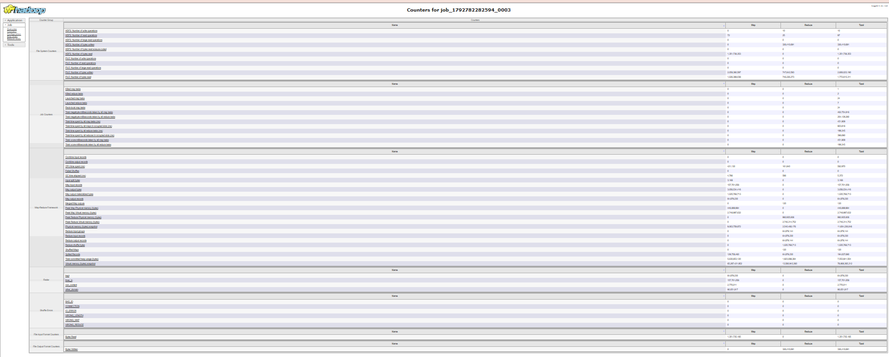
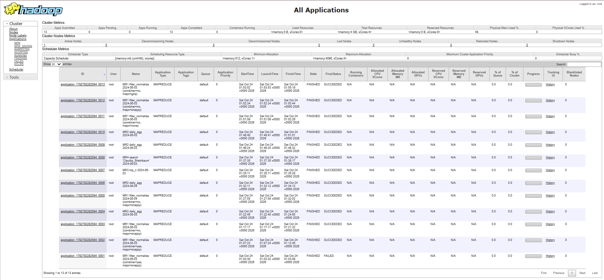
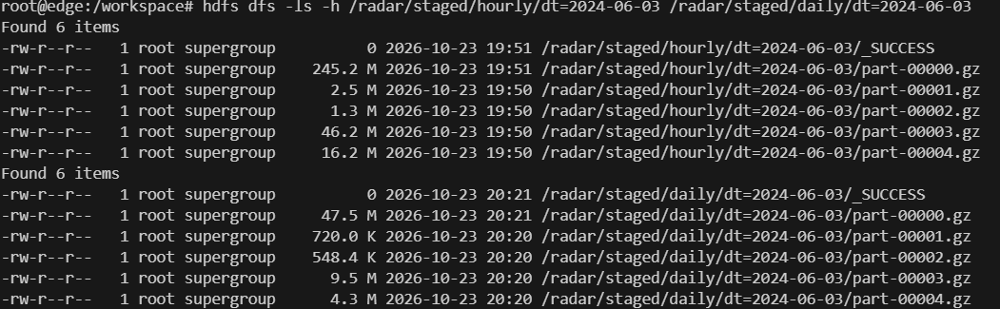
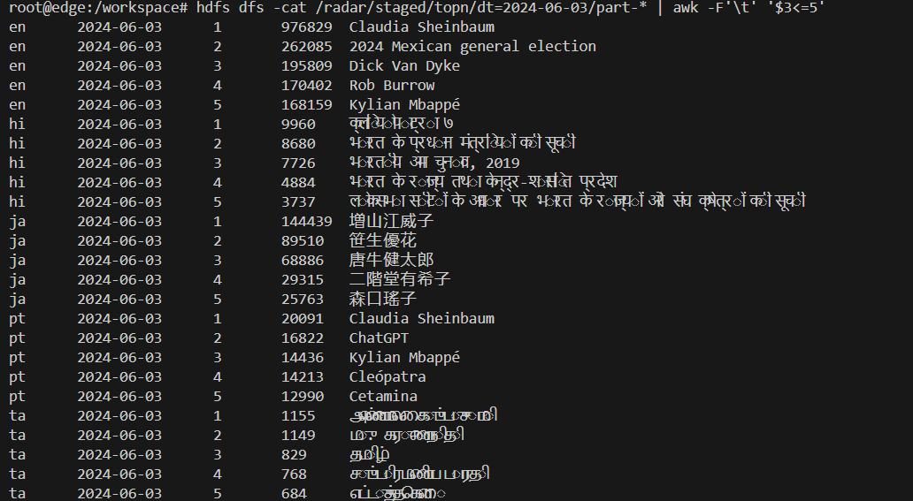
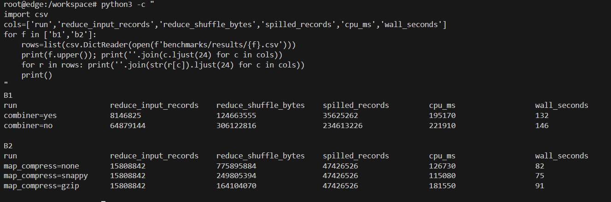

# Phase 2 results: MapReduce

Notes and numbers from the Phase 2 runs, kept here so they can go straight into the final report. All runs were on the dev days (2024-06-03 and 2024-06-04) on the single-node Docker cluster (YARN: 4 GB, 4 vcores).

## Jobs

| Job | What it does | Input → output (2024-06-03) | Time |
|---|---|---|---|
| MR1 filter_normalise | Keeps en/hi/ta/ja/pt desktop + mobile rows, drops namespace pages and main pages, decodes titles | 157,701,058 raw lines → 64,879,144 hourly rows (326 MB gz) | 259 s |
| MR2 daily_agg | Adds up hours and platforms into one row per article per day | 64,879,144 → 7,945,069 daily rows (62 MB gz) | 130 s |
| MR3 top_n | Top 100 articles per language per day using a secondary sort | 7,945,069 → 500 rows | 23 s |
| MR4 search | Map-only scan for one title | 64,879,144 rows → 48 matches | 47 s |

Every input line of MR1 is accounted for by its counters: kept 64,879,230 + other projects/languages 90,051,817 + namespace and main pages 2,770,011 = 157,701,058, with 0 malformed lines. 86 rows were merged by the reducer because two different raw spellings decode to the same title (for example `Rock_%26_Roll` and `Rock_&_Roll`). June 4 behaved the same way (156,201,224 lines in, 63,965,878 rows out, 253 s).

*Job counters for MR1 on 2024-06-03 (job 0003) in the JobHistory server. The Radar group holds the mapper's own counters (`lines_in`, `kept`, `non_content`, `other_domain`); `Reduce input groups` = 64,879,144 confirms the full 4-field key reached the reducers.*

Cross-check: MR4's 48 hourly rows for "Claudia Sheinbaum" add up to 976,829, exactly the figure MR3 reports for her at rank 1. 74% of those views came from mobile.

*All Phase 2 jobs in the YARN ResourceManager. Job 0001 is the first MR1 attempt that failed on a Python import problem; job 0002 is the run with the combiner key problem described below.*

## Custom partitioner

`LangPartitioner` (Java, `mapreduce/java/`) sends each language to its own reducer, so each output folder has one file per language in a fixed order: part-00000 en, 00001 hi, 00002 ta, 00003 ja, 00004 pt. The file sizes follow each Wikipedia's traffic.

*MR1 (hourly) and MR2 (daily) output for 2024-06-03. Daily data is about a fifth of the hourly size.*

## Top articles on 2024-06-03 (MR3)

The lists match real events from that day: Claudia Sheinbaum's win in the Mexican election (en and pt), Rob Burrow's death, Kylian Mbappé's move to Real Madrid, the death of voice actress Eiko Masuyama (ja), Yuka Saso's US Women's Open win (ja), Indian election pages the day before counting (hi), and M. Karunanidhi's 100th birth anniversary (ta). This is the project's core idea working before any spike detection is added.

## Benchmark B1: combiner (MR2, full day)

| | Without combiner | With combiner | Change |
|---|---|---|---|
| Records reaching reducers | 64,879,144 | 8,146,825 | −87% |
| Shuffle bytes | 306.1 MB | 124.7 MB | −59% |
| Spilled records | 234,613,226 | 35,625,262 | −85% |
| CPU time | 221.9 s | 195.2 s | −12% |
| Wall time | 146 s | 132 s | −10% |

Wall time improves much less than data volume because the English mapper reads one 245 MB gzip file on its own (gzip cannot be split), and that single task sets the finish time.

The combiner was also tried in MR1, where it did not help: `Combine input records` and `Combine output records` were almost equal, because each hourly file already contains every article only once. Removing it made MR1 20% faster (326 s → 259 s). The combiner is therefore used only in MR2, where one mapper sees up to 48 rows (24 hours × 2 platforms) for the same article.

## Benchmark B2: map-output compression (MR1, 6 hours)

| | None | Snappy | Gzip |
|---|---|---|---|
| Shuffle bytes | 775.9 MB | 249.8 MB (−68%) | 164.1 MB (−79%) |
| CPU time | 126.7 s | 115.1 s | 181.6 s |
| Wall time | 82 s | 75 s | 91 s |

Snappy was the fastest: compressing is cheap enough that writing a third of the data to disk saves more than it costs. Gzip gives the smallest shuffle but uses about 50% more CPU, which made it the slowest. The jobs therefore use Snappy for the shuffle and Gzip for the final output, which is stored and read many times.

Each setting was run once on one laptop, so differences of a few seconds should be treated as noise. Record and byte counts are exact. In both benchmarks every run wrote byte-identical output, so the settings changed only how the work was done, not the result.

## Problems found and fixed

1. **Python import failed inside YARN.** `-files` places each shipped file in its own cache folder and links it into the task folder. Python looks for imports next to the real file, not the link, so `mr1_mapper.py` could not find `common_title.py`. Local pipe tests passed because there all files sit in one folder. Fix: `-cmdenv PYTHONPATH=.`.
2. **Streaming combiner changed the key.** Hadoop Streaming splits a combiner's output into key and value using the *reduce* output settings, which default to one key field. After the combiner, rows were keyed by language only. The job still reported success, but `Reduce input groups` was 5 instead of about 65 million. Fix: set `stream.num.reduce.output.key.fields` equal to `stream.num.map.output.key.fields`. This is why the counters are checked after every run, not only the job status.
