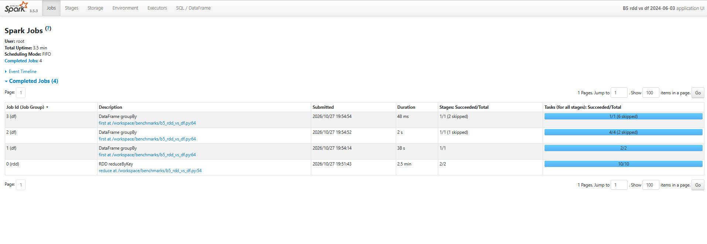
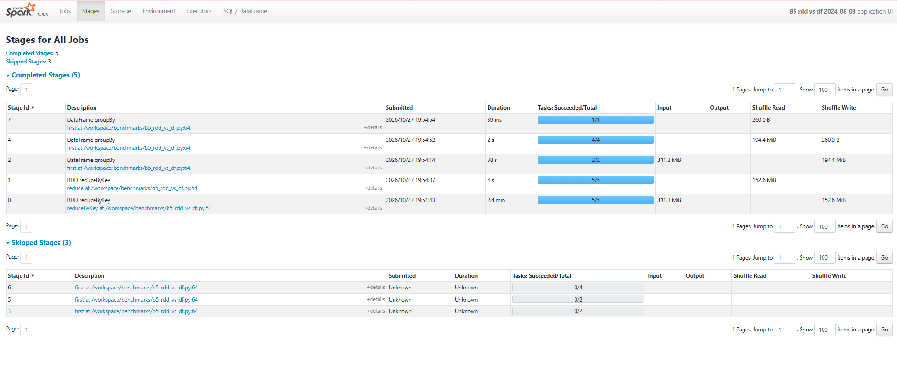
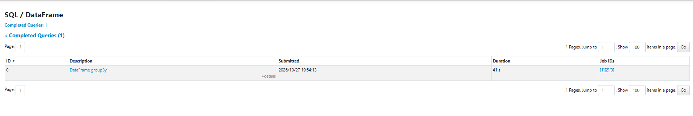
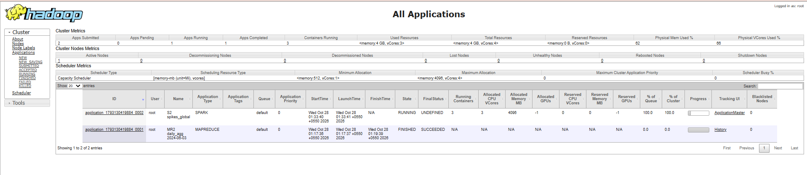

# Phase 4 results: Spark spike detection

Notes and numbers from the Phase 4 runs, for the final report. Spark 3.5.3 (PySpark) ran in local mode inside the edge container (`local[3]`, 3 GB driver) unless noted, reading the ORC warehouse from HDFS. The detection period is 2024-06-01 to 2024-06-14, and the hourly baseline starts on 2024-05-25. Threshold tuning is written up separately in `report/tuning_notes.md`.

## Full-period data

Phase 3 only loaded the two dev days. Before detection could run, `scripts/prepare_full.sh` ran MR1 and MR2 for the other 19 hourly days and then loaded everything into the ORC warehouse with Spark. It ran unattended and took 180 minutes: about 6 to 7 minutes per day for MR1 + MR2, and about 3.5 minutes per day for the Spark load.

| Warehouse table | Days | Rows | Views |
|---|---|---|---|
| hourly_views | 21 (05-25 to 06-14) | 1,015,912,437 | 5,611,635,136 |
| daily_views | 21 | 164,733,285 | 5,611,635,136 |
| country_daily | 31 (05-15 to 06-14) | 8,582,343 | |

On every day, hourly and daily views add up to the same total. After `hive/02_warehouse.hql` registered the new partitions, Hive read all 1.02 billion hourly rows in 73 seconds.

## Jobs

| Job | What it does | Result | Time |
|---|---|---|---|
| S0 rdd_demo | RDD lineage and caching on one raw hourly file | 7,439,943 lines; count 6.5 s, filling the cache 14.8 s, from the cache 1.3 s | |
| S1 build_series | Candidates (articles over the per-language `min_views` in some hour) × 504 hours, missing hours filled with 0 | 24,047 series, 12,119,688 rows, T-D5 PASS | 146 s |
| S2 spikes_global | Robust baseline (median and IQR of the previous 168 hours) per series and day, spike rule, episodes | 12,338 episodes, 43 suspicious, T-D6 PASS | 64 s |
| S3 spikes_country | The same per (country, Wikidata item), daily, 14-day window | 17,041 episodes from 43,334 candidates | 112 s |
| S4 enrich | Titles → Wikidata items, categories, location; MongoDB cache | 16,804 pages, 99.9% with an item (T-D7 PASS), 31% "Other" | 406 s first run, 222 s with the cache |
| S5 events | Groups spikes into events (union-find), score, scopes, ±48 h curve | 16,822 events, largest 20 items (T-D8 PASS) | 23 s |

S0 shows why caching matters for an RDD that is used more than once: the second count read 2.9 million rows from memory in 1.3 s instead of re-reading and re-filtering the gzip file. The file is read by one task, because a gzip file cannot be split.

S2 and S3 run the per-series detection with `groupBy().applyInPandas`. Each series (one article, or one country and item) arrives in a Python worker as a pandas DataFrame, and the same numpy code that the unit tests check (`spark/common/spikes.py`) runs on it. 24,047 hourly series took about a minute.

## What was found

The top events are real events from those two weeks, each grouped across languages and countries:

- the French Open finals (Alcaraz and Zverev on 06-09, Świątek on 06-08)
- the Champions League final on 06-01 (Ancelotti, Kroos, Dortmund)
- the Indian election result on 06-04, the new ministers on 06-09, and Odisha's new chief minister on 06-11
- Claudia Sheinbaum's election in Mexico, with spikes in 3 languages and dozens of countries
- the deaths of Jerry West (06-12) and Michael Mosley (found 06-09)
- the Euro 2024 opening match on 06-14, where the Scotland team, its players and "Flower of Scotland" form one event of 20 linked items

Country spikes show the same story locally. India's top 10 is entirely the election result and the new government. Japan shows Gainax's bankruptcy and the deaths of Eiko Masuyama and Katsura Zakoba, and the UK shows Michael Mosley.

## Benchmark B4: MapReduce vs Spark (daily aggregation, 2024-06-03)

| Engine | Time | Rows | Views |
|---|---|---|---|
| MapReduce (MR2, Hadoop Streaming on YARN) | 128 s | 7,945,069 | 274,484,789 |
| Spark DataFrame (local[3]) | 53.7 s | 7,945,069 | 274,484,789 |

Spark was 2.4 times faster on the same input with an identical result. MR2 starts a Python process per task and writes the map output to disk before the shuffle. Spark keeps the aggregation in the JVM and needs no separate job setup on YARN.

## Benchmark B5: RDD vs DataFrame (same aggregation, 65 million rows)

| API | Time | Shuffle write |
|---|---|---|
| RDD `map` + `reduceByKey` | 149.7 s | 160.0 MB |
| DataFrame `groupBy().sum()` | 43.0 s | 203.8 MB |

Both produced the same 7,945,069 rows and 274,484,789 views. The DataFrame version was 3.5 times faster even though it shuffled more data. In the RDD version every one of the 65 million rows is split and summed by Python lambdas, so each row is sent from the JVM to a Python worker and back. The DataFrame version never leaves the JVM: Catalyst plans it as a partial aggregation before the shuffle and a final one after it, and Tungsten generates code for both. The Stages tab shows where the time went: the RDD's first stage took 2.4 minutes, the DataFrame's 38 seconds. The larger shuffle is Spark's internal row format, which is less compact than the pickled Python tuples; it costs a few seconds, not minutes.

## Spark on YARN (step 4.15)

S2 was also run on YARN with `scripts/spark_yarn.sh` (client mode, 2 executors with 1 core and 1 GB each, 512 MB for the application master). The project's Python packages are shipped to the executors as a zip with `--py-files`, because the NodeManager container does not have the project folder.

| | Local `local[3]` | YARN, 2 executors |
|---|---|---|
| Time | 64 s | 113 s |
| Episodes | 12,338 | 12,338 |

The result is identical. YARN was slower here for two reasons. Before the job starts, YARN uploads Spark's libraries to HDFS and launches three containers (the application master and two executors). Then only 2 tasks run at a time, against 3 in local mode, because the single 4 GB NodeManager has no room for more. On a real cluster with many nodes the same code would spread across them without changes, which local mode cannot do.

## What did not work, and what changed

1. **Too many spikes at first.** The first thresholds gave 37,073 hourly and 55,316 country episodes; almost every candidate had one. The final settings came from measuring how many episodes each stricter setting would keep (`s2_inspect.py`, `s3_inspect.py`). See `tuning_notes.md`.
2. **Country data hides small counts.** Wikimedia does not publish a (country, article, day) count under 90 views. Many items had a baseline of all zeros, so any day with 500 views passed the old ratio of 3. The country rule now needs 1,000 views and a ratio of 10.
3. **Hindi titles broke the Wikipedia API call (HTTP 414, URI too long).** Each Devanagari character is 9 characters once encoded, so 50 titles did not fit in a URL. Title lookups are now sent as POST requests.
4. **Half the pages were "Other".** Category rules only looked one level up the Wikidata class tree, so "2019 Indian general election" (→ Lok Sabha election → general election → public election) did not match. Classes and occupations are now walked up to three levels, and "Other" fell from 49% to 31%.
5. **One event of 363 spikes.** Country spikes only have a date, so linking items through them chained a player, his club and his teammates into one blob. Links now only join hourly spikes. The size check was also changed to count different items, because one item spiking in 48 countries is one story, not a merge error.
6. **The Spark UI at localhost:4040 was empty during the YARN run.** In YARN mode Spark redirects its UI through the ResourceManager's proxy at `http://resourcemanager:8088/proxy/<application id>/`, a host name that only exists inside Docker. The same page opens from Windows by replacing `resourcemanager` with `localhost`.

## Screenshots (report/assets/)

| File | Shows |
|---|---|
| `p4_b5_jobs.png` | B5 in the Spark UI: the RDD job (2.5 min) against the DataFrame jobs (38 s + 2 s) |
| `p4_b5_stages.png` | B5 stages with input, shuffle read and shuffle write |
| `p4_b5_sql.png` | The DataFrame query in the SQL tab |
| `p4_yarn_apps.png` | YARN ResourceManager: S2 running as a SPARK application (3 containers, 4 GB) next to the MR2 run from B4 |

